# ITNPA4-B34 – Text Mining Project: Researchly Expert System and Research Topic Analysis

**Student:** Euclid Thakanyane  
**Module:** ITNPA4-B34  
**Datasets:** `research_abstracts.json` and `research_corpus.zip` (Matanga, 2026)  
**Code:** `notebooks/Q1_Q2_Researchly_Expert_System.ipynb` and `notebooks/Q3_Q4_Topic_Analysis.ipynb` (in the submitted code zip). All the numbers below come from those notebooks after they were run.

---

# Part A – Research Papers Expert System (Questions 1 and 2)

## 1.1 Load and denoise the data (6 marks)

**Loading.** `research_abstracts.json` is a column-oriented JSON file (`{"DOI": {...}, "Abstract": {...}, "Label": {...}}`), so `pandas.read_json` loads it straight into a data frame of **1 138 rows × 3 columns**:

| Column | Type | Missing | Unique values |
|---|---|---|---|
| DOI | text (identifier) | 4 | 1 134 |
| Abstract | text | 0 | 1 125 |
| Label | text (target) | 0 | 2 (`classical`, `ai`) |

The abstracts are about inflation and economic forecasting. `Label` says whether a paper uses an **AI / machine-learning method** (`ai`) or a **classical econometric/statistical method** (`classical`). The classes are imbalanced: **900 classical (79%) and 238 ai (21%)**.

**Noise audit.** Before cleaning, I counted how many abstracts contain each type of noise:

| Noise type | Abstracts affected |
|---|---|
| Digits (years, sample sizes, percentages) | 689 |
| Non-ASCII characters (Unicode hyphens U+2010, curly quotes, ©) | 443 |
| LaTeX maths (`$...$`) | 18 |
| Publisher copyright notices ("Copyright © 2008 John Wiley & Sons, Ltd.") | 16 |
| URLs | 7 |
| LaTeX commands (`\alpha` etc.) | 5 |
| HTML tags | 0 |

**Denoising pipeline.** I wrote the cleaning code as a module (`deployment/preprocess.py`) so that training and the web app use exactly the same cleaning. The steps are:

1. **Record-level cleaning:** drop rows with a null `Abstract`/`Label`, strip whitespace, remove **13 duplicate abstracts**, and drop texts that have fewer than 5 tokens left after cleaning. This leaves **1 125 rows (890 classical / 235 ai)**.
2. **Unicode normalisation:** NFKC, then map Unicode hyphens and dashes to ASCII, then NFKD with ASCII folding.
3. **Regex noise removal:** copyright sentences, LaTeX maths and commands, HTML tags and entities, URLs/DOIs, and e-mail addresses.
4. **Lower-casing**, then removing digits and punctuation (only `a–z` is kept), then collapsing whitespace.
5. **Linguistic normalisation with spaCy (`en_core_web_sm`):** lemmatisation, removal of spaCy's 326 English stop words plus domain stop words ("paper", "study", "propose", "elsevier", "wiley", …), and removal of tokens shorter than 3 characters.

```python
COPYRIGHT  = re.compile(r"(copyright|©|\(c\))[^.]*(\.|$)", re.I)
LATEX_MATH = re.compile(r"\$[^$]*\$");   LATEX_CMD = re.compile(r"\\[a-zA-Z]+(\{[^}]*\})?")
HTML = re.compile(r"<[^>]+>|&[a-z]+;");  URL = re.compile(r"https?://\S+|www\.\S+|doi:\s*\S+", re.I)

def denoise(text):
    text = unicodedata.normalize("NFKC", text).replace("\u2010", "-")
    text = unicodedata.normalize("NFKD", text).encode("ascii", "ignore").decode("ascii")
    for pat in (COPYRIGHT, LATEX_MATH, LATEX_CMD, HTML, URL, EMAIL):
        text = pat.sub(" ", text)
    text = NON_ALPHA.sub(" ", text.lower().replace("-", " "))
    return SPACES.sub(" ", text).strip()

def clean_text(text):                       # denoise + spaCy lemmatisation + stop-word removal
    doc = _nlp(denoise(text))
    return " ".join(t.lemma_ for t in doc if t.lemma_ not in STOPWORDS and len(t.lemma_) > 2 and t.is_alpha)

df = pd.read_json("../datasets/research_abstracts.json")
df = df.dropna(subset=["Abstract", "Label"]).drop_duplicates(subset=["Abstract"])
df["clean_abstract"] = clean_many(df["Abstract"].tolist())
```

**Example (end of an abstract):**

* *Before:* "…This superior performance is consistent across subsamples and a number of inflation measures. Copyright © 2008 John Wiley & Sons, Ltd."
* *After:* "…bayesian model averaging pseudo sample prediction inflation generally accurate forecast simple equal weighted average superior performance consistent subsample number inflation measure"

**Result.** After cleaning, **no abstract** contains digits, non-ASCII characters, LaTeX, URLs, HTML or copyright notices. The median abstract length fell from **152 raw words to 86 informative tokens**, so the remaining vocabulary carries the semantic content. The cleaned data frame is saved as `datasets/research_abstracts_clean.csv`.

## 1.2 Identify columns relevant for feature engineering (5 marks)

I used four feature-modelling techniques to decide which columns to use.

**(a) Column profiling.** `DOI` is unique for 99.6% of rows and 4 values are missing, so it is a record identifier. `Abstract` holds free text, and `Label` has only two values, which makes it the target.

**(b) Mutual information (MI) with the label.** I encoded each candidate column and computed its MI with the label:

| Candidate feature | MI with Label (nats) |
|---|---|
| DOI (identifier, ordinal-encoded) | 0.5125 |
| clean_abstract (TF-IDF → 20 LSA components, summed) | 0.3515 |
| DOI prefix (publisher registrant) | 0.1924 |
| Abstract length (words) | 0.0296 |

The DOI's MI of 0.5125 is exactly the **entropy of the label (0.5125 nats)**. A unique identifier always reaches this upper bound because it simply memorises each row, so it carries no generalisable information. The DOI prefix (publisher) has some association with the label (for example, IEEE `10.1109` papers are mostly `ai`, as Figure 1.2a shows), but this is bibliographic metadata. A researcher pasting a new abstract into Researchly would not have it, and using it would make the model classify by publisher instead of by content. Abstract length has almost no relationship with the label (MI 0.03; the box plot shows similar distributions).

**(c) Chi-square term selection on the text.** A bag-of-words of the cleaned abstracts (2 868 terms with `min_df = 3`) gives **674 terms significantly associated with the label (p < 0.05)**. The most discriminative terms are:

* **ai:** machine (χ² = 397.7), network (372.4), neural (350.3), algorithm (287.1), method (278.0), learning (237.1), regression (189.4), gold (183.0), ann (169.3), lstm (166.6)
* **classical:** monetary (58.9), policy (58.5), shock (48.3), effect (40.3), wage (38.1), nominal (35.8), real (31.8), interest (31.4), theory (26.4), fiscal (25.4)

**(d) Label distribution and word clouds.** The 79/21 imbalance means I need a **stratified split** and **macro-F1 / ai-class F1** as headline metrics, because plain accuracy would reward always predicting `classical`.

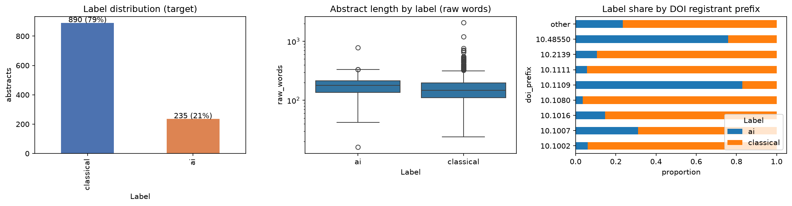

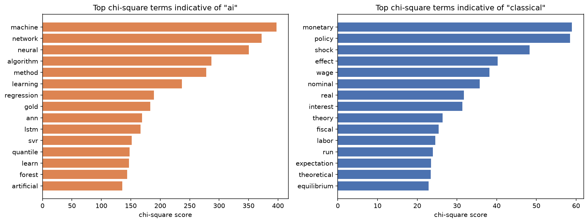

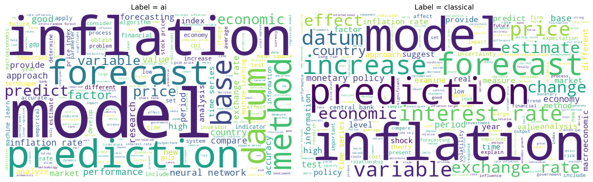

**Decision.** The feature column is **`clean_abstract`** (derived from `Abstract`), represented with **TF-IDF**. The target is **`Label`**. `DOI` is dropped as a non-semantic identifier, and length is dropped because it is uninformative.

## 1.3 Baseline model (9 marks)

**Design.** I used a stratified 80/20 train–test split (**900 train / 225 test**, `random_state = 42`). The baseline is a **TF-IDF + Multinomial Naïve Bayes** pipeline with default settings, which is the classic simple text classifier. As a sanity check I also report a majority-class `DummyClassifier`. To measure generalisation I used **5-fold stratified cross-validation** on the training set and a **learning curve**.

```python
X_train, X_test, y_train, y_test = train_test_split(X, y, test_size=0.2, stratify=y, random_state=42)
baseline = Pipeline([("tfidf", TfidfVectorizer()), ("clf", MultinomialNB())])
baseline.fit(X_train, y_train)
cross_validate(baseline, X_train, y_train, cv=StratifiedKFold(5, shuffle=True, random_state=42),
               scoring=["accuracy", "f1_macro", "roc_auc"])
```

**Performance report – learning (train) vs generalisation (test and CV):**

| Model | Train accuracy | Train macro-F1 | Test accuracy | Test macro-F1 | Test F1 (ai) | Test recall (ai) | Test ROC-AUC | 5-fold CV macro-F1 |
|---|---|---|---|---|---|---|---|---|
| Dummy (majority) | 0.791 | 0.442 | 0.791 | 0.442 | 0.000 | 0.000 | 0.500 | 0.442 |
| **Baseline TF-IDF + MultinomialNB** | 0.819 | 0.566 | **0.809** | **0.524** | **0.157** | 0.085 | 0.917 | 0.468 ± 0.024 |

Test classification report (baseline):

| Class | Precision | Recall | F1 | Support |
|---|---|---|---|---|
| ai | 1.000 | 0.085 | 0.157 | 47 |
| classical | 0.805 | 1.000 | 0.892 | 178 |
| macro avg | 0.903 | 0.543 | 0.525 | 225 |

Confusion matrix on the test set: only **4 of the 47 ai abstracts** were recognised, and 43 were labelled `classical`. All 178 classical abstracts were correct.

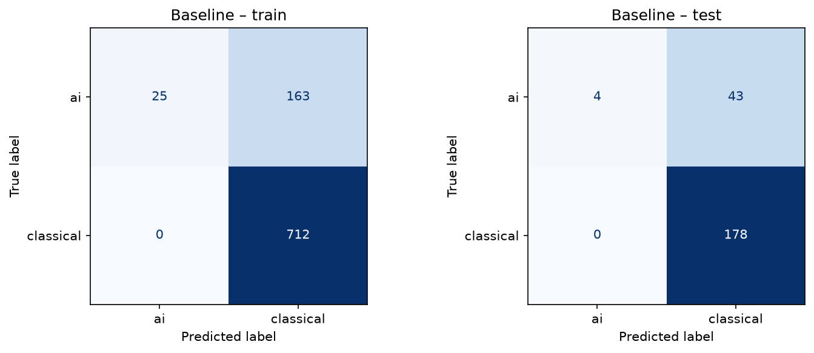

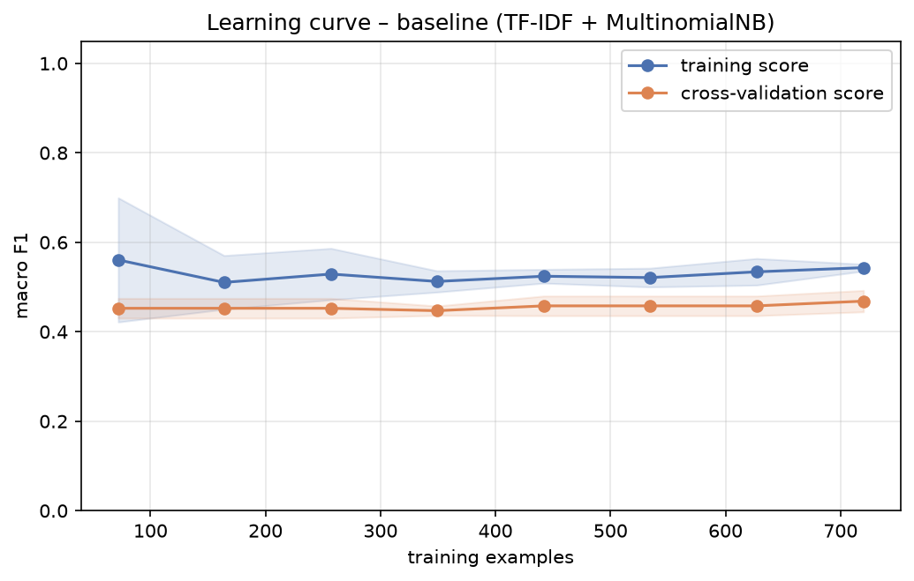

**Comment.** The baseline's 80.9% accuracy looks acceptable, but that is only 1.8 points above the dummy model (79.1%). The macro-F1 of 0.524 and ai-F1 of 0.157 show that it **almost always predicts the majority class**. The model **underfits** and has **high bias**:

* even on the training data it reaches only 0.566 macro-F1;
* the training and cross-validation curves are flat (about 0.51–0.56 and 0.45–0.47) and close together, so adding more data would not help.

The cause is the class prior. Multinomial NB multiplies the likelihood by the 79% `classical` prior, and with the default smoothing (α = 1) on short TF-IDF vectors the minority-class evidence rarely overcomes it. The ROC-AUC of 0.917 is the encouraging part: the model *ranks* ai abstracts reasonably well, but its decision threshold is badly placed. So the baseline sets a low bar, and the target for Question 2 is clear: **raise ai recall and macro-F1 without losing generalisation**.

## 2.1 Four machine-learning models (10 marks)

On the same Question 1 data frame and split, I trained **five** models. Each is a scikit-learn pipeline with TF-IDF (`sublinear_tf=True, min_df=2`). Where the algorithm supports it, I used class weighting to deal with the imbalance:

```python
models = {
  "Logistic Regression": LogisticRegression(max_iter=2000, class_weight="balanced"),
  "Linear SVM":          LinearSVC(class_weight="balanced"),
  "Complement NB":       ComplementNB(),
  "Random Forest":       RandomForestClassifier(n_estimators=400, class_weight="balanced_subsample", random_state=42),
  "Gradient Boosting":   GradientBoostingClassifier(random_state=42)}
for name, clf in models.items():
    pipe = Pipeline([("tfidf", TfidfVectorizer(sublinear_tf=True, min_df=2)), ("clf", clf)])
    rows.append(evaluate(pipe, name))      # train/test metrics + 5-fold CV
```

| Model | Train macro-F1 | Test accuracy | Test macro-F1 | Test F1 (ai) | Test recall (ai) | Test precision (ai) | Test ROC-AUC | CV macro-F1 (mean ± sd) |
|---|---|---|---|---|---|---|---|---|
| Baseline MultinomialNB | 0.566 | 0.809 | 0.524 | 0.157 | 0.085 | 1.000 | 0.917 | 0.468 ± 0.024 |
| Logistic Regression | 0.967 | 0.893 | 0.844 | 0.755 | 0.787 | 0.726 | 0.940 | 0.830 ± 0.018 |
| **Linear SVM** | 0.998 | **0.920** | **0.873** | **0.796** | 0.745 | 0.854 | 0.945 | **0.850 ± 0.029** |
| Complement NB | 0.909 | 0.902 | 0.822 | 0.703 | 0.553 | 0.963 | 0.931 | 0.798 ± 0.047 |
| Random Forest | 1.000 | 0.920 | 0.858 | 0.763 | 0.617 | 1.000 | 0.940 | 0.791 ± 0.025 |
| Gradient Boosting | 0.972 | 0.911 | 0.848 | 0.750 | 0.638 | 0.909 | 0.889 | 0.844 ± 0.020 |

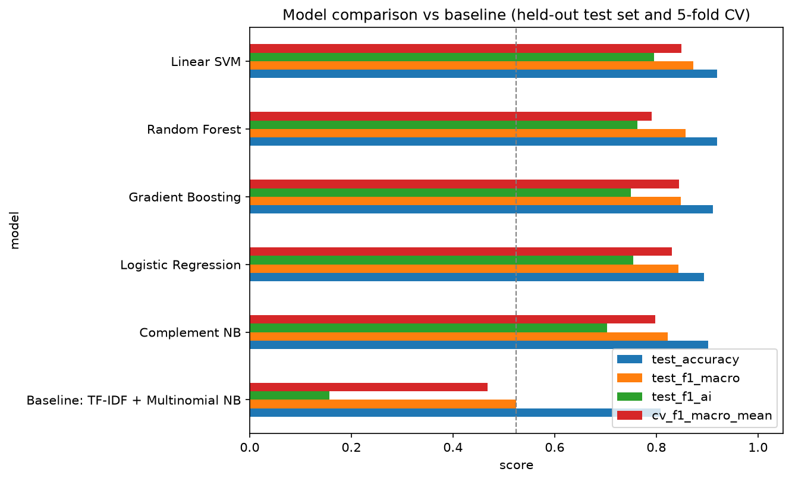

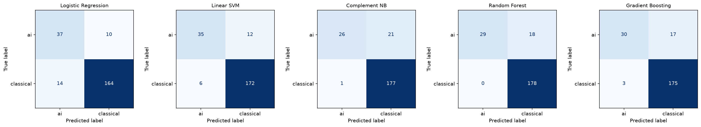

**Comment.** All five models clearly beat the baseline. Test macro-F1 rises from 0.524 to between 0.822 and 0.873, and ai-F1 rises from 0.157 to between 0.70 and 0.80. The **linear models work best**, which fits the nature of text data: TF-IDF features are high-dimensional and sparse, and the classes are close to linearly separable, so a maximum-margin (SVM) or regularised linear (LR) boundary suits them.

* **Linear SVM** is the best untuned model (test macro-F1 0.873, CV 0.850).
* **Logistic Regression** has the highest ai recall (0.787), which suits the screening use case where a missed AI paper is costly.
* **Random Forest** has perfect training scores but a lower CV macro-F1 (0.791), a sign of **overfitting**. It is also conservative on the minority class (ai recall 0.617).
* **Complement NB**, which is designed for imbalanced text (Rennie et al., 2003), fixes most of Multinomial NB's majority-class bias (ai-F1 0.703 against 0.157).

## 2.2 Performance enhancement – hyper-parameter optimisation with GridSearchCV (10 marks)

**Approach.** Apart from changing the model, I tuned the **whole pipeline** (feature engineering and classifier) with an exhaustive **GridSearchCV**. I used 5-fold stratified CV on the training data only, with **macro-F1** as the objective. The grid covers:

* the **n-gram range** (unigrams, bigrams, trigrams);
* `min_df` (vocabulary pruning);
* sub-linear TF scaling;
* the regularisation strength `C`.

That is 90 configurations × 5 folds for each of the two strongest model families.

```python
grid = {"tfidf__ngram_range": [(1, 1), (1, 2), (1, 3)], "tfidf__min_df": [1, 2, 3],
        "tfidf__sublinear_tf": [True, False], "clf__C": [0.5, 1, 5, 10, 30]}
gs = GridSearchCV(Pipeline([("tfidf", TfidfVectorizer()),
                            ("clf", LogisticRegression(max_iter=3000, class_weight="balanced"))]),
                  grid, scoring="f1_macro", cv=StratifiedKFold(5, shuffle=True, random_state=42), n_jobs=-1)
gs.fit(X_train, y_train)
```

**Best configurations found:**

* Logistic Regression: `C = 10, ngram_range = (1,1), min_df = 1, sublinear_tf = True`
* Linear SVM: `C = 1, ngram_range = (1,1), min_df = 1, sublinear_tf = True`

**Before vs after tuning:**

| Model | Metric | Before (default) | After (tuned) | Change |
|---|---|---|---|---|
| Logistic Regression | Test accuracy | 0.893 | 0.916 | +0.022 |
| Logistic Regression | Test macro-F1 | 0.844 | **0.869** | **+0.026** |
| Logistic Regression | Test F1 (ai) | 0.755 | 0.791 | +0.036 |
| Logistic Regression | Test ROC-AUC | 0.940 | 0.946 | +0.006 |
| Logistic Regression | CV macro-F1 | 0.830 | **0.858** | **+0.028** |
| Linear SVM | Test accuracy | 0.920 | 0.924 | +0.004 |
| Linear SVM | Test macro-F1 | 0.873 | 0.881 | +0.008 |
| Linear SVM | Test F1 (ai) | 0.796 | 0.809 | +0.014 |
| Linear SVM | Test ROC-AUC | 0.945 | 0.945 | +0.001 |
| Linear SVM | CV macro-F1 | 0.850 | 0.856 | +0.006 |

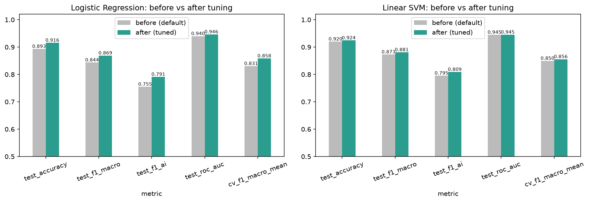

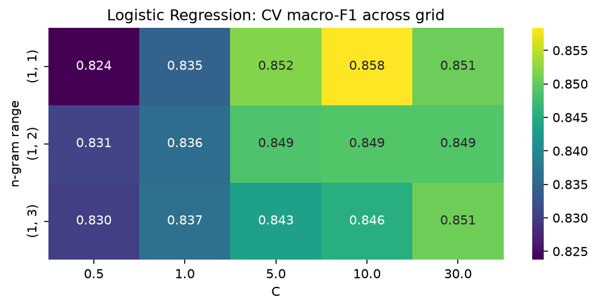

**Final (deployed) model.** To avoid choosing a model on the test set, I picked the final configuration by **cross-validated macro-F1 on the training data**. The tuned Logistic Regression has the highest CV score (0.858, against 0.856 for the tuned SVM), and it also gives real class probabilities for the web interface. Compared with the baseline:

| Metric (test set) | Baseline (MultinomialNB) | Final tuned Logistic Regression |
|---|---|---|
| Accuracy | 0.809 | **0.916** |
| Macro-F1 | 0.524 | **0.869** |
| F1 (ai) | 0.157 | **0.791** |
| Recall (ai) | 0.085 | **0.766** |
| Precision (ai) | 1.000 | 0.818 |
| ROC-AUC | 0.917 | **0.946** |
| 5-fold CV macro-F1 | 0.468 | **0.858 ± 0.022** |

The final model's test confusion matrix shows **36 of 47 ai** and **170 of 178 classical** abstracts classified correctly (11 false negatives and 8 false positives), against 4 of 47 ai for the baseline.

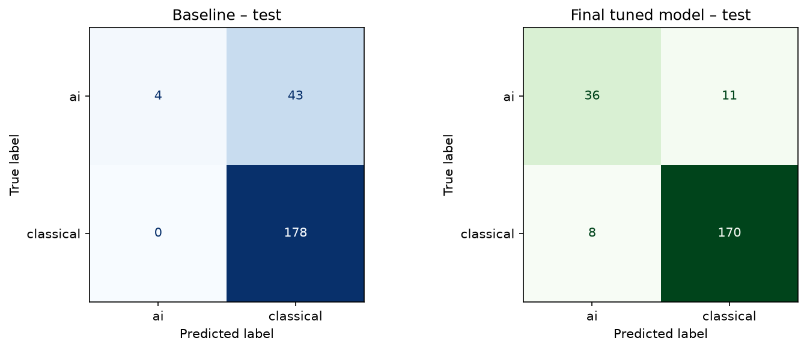

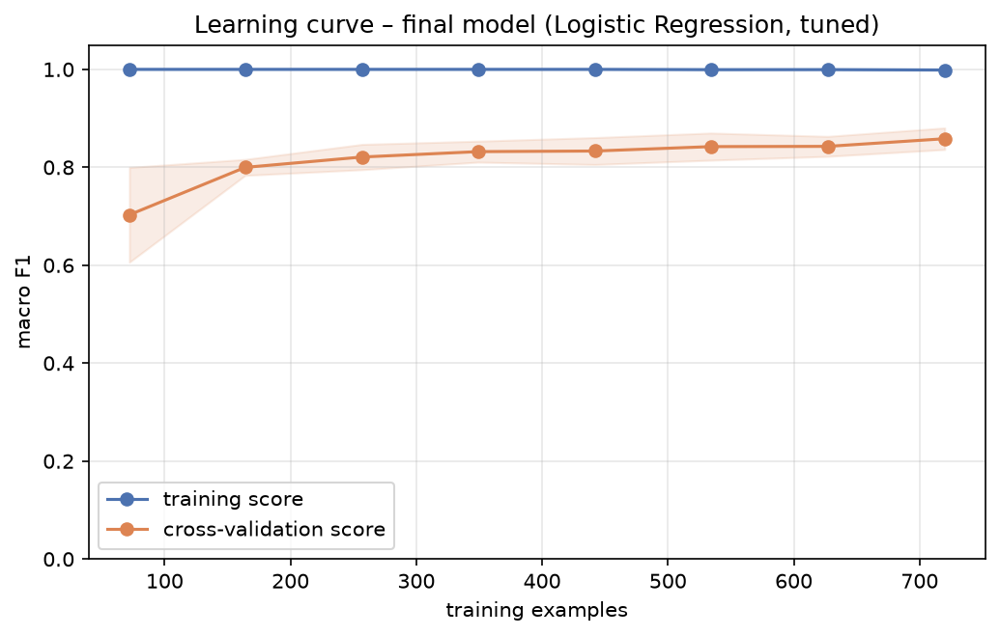

**Comment.** Tuning improved every model family. The biggest gain was for Logistic Regression: +2.6 points of test macro-F1, +3.6 points of ai-F1 and +2.8 points of CV macro-F1. Two things drive it:

* **weaker regularisation** (C = 10), which lets rare but highly discriminative terms such as "lstm", "ann" and "svr" get larger weights;
* **`min_df = 1`**, which keeps those rare technical terms in the vocabulary.

Bigrams and trigrams did *not* help. On 900 short training abstracts they increase sparsity faster than they add signal, and the grid search showed this objectively rather than leaving it to assumption.

The learning curve of the final model shows a typical **low-bias, moderate-variance** pattern. The training score is about 1.0, while the CV score rises steadily from 0.70 (72 examples) to 0.86 (720 examples) and has not yet levelled off. **More labelled abstracts would therefore still improve generalisation.** The gap of about 0.14 between training and CV scores suggests mild overfitting, which is normal for a high-dimensional text model.

## 2.3 Web-interface deployment (10 marks)

I deployed the best configuration (tuned TF-IDF + Logistic Regression, refitted on all 1 125 cleaned abstracts) as a **Streamlit** web application:

* `deployment/model.joblib` – the trained scikit-learn pipeline, saved with `joblib`;
* `deployment/preprocess.py` – the same denoising and lemmatisation used in training;
* `deployment/app.py` – the user interface.

The user pastes an abstract into a text box and presses **Predict**. The app then shows the predicted category, the confidence, a probability bar chart and table, and (in an expander) the denoised text that was fed to the model. The sidebar shows the model and its held-out test metrics.

```python
model = joblib.load(HERE / "model.joblib")
text = st.text_area("Research abstract", height=220)
if st.button("Predict", type="primary"):
    cleaned = clean_text(text)                         # identical preprocessing to training
    proba = model.predict_proba([cleaned])[0]
    pred = model.classes_[proba.argmax()]
    st.success(f"Predicted category: **{pred}** (confidence {proba.max():.1%})")
    st.bar_chart(pd.DataFrame({"category": model.classes_, "probability": proba}).set_index("category"))
```

To run it: `pip install -r deployment/requirements.txt` and then `streamlit run deployment/app.py` (see `deployment/README.md` for the local, Docker and Streamlit Cloud options). I tested the app while it was running, using headless Chromium:

* an LSTM / random-forest inflation-forecasting abstract → **ai (99.9%)**;
* a New Keynesian Phillips curve / structural VAR abstract → **classical (99.8%)**.

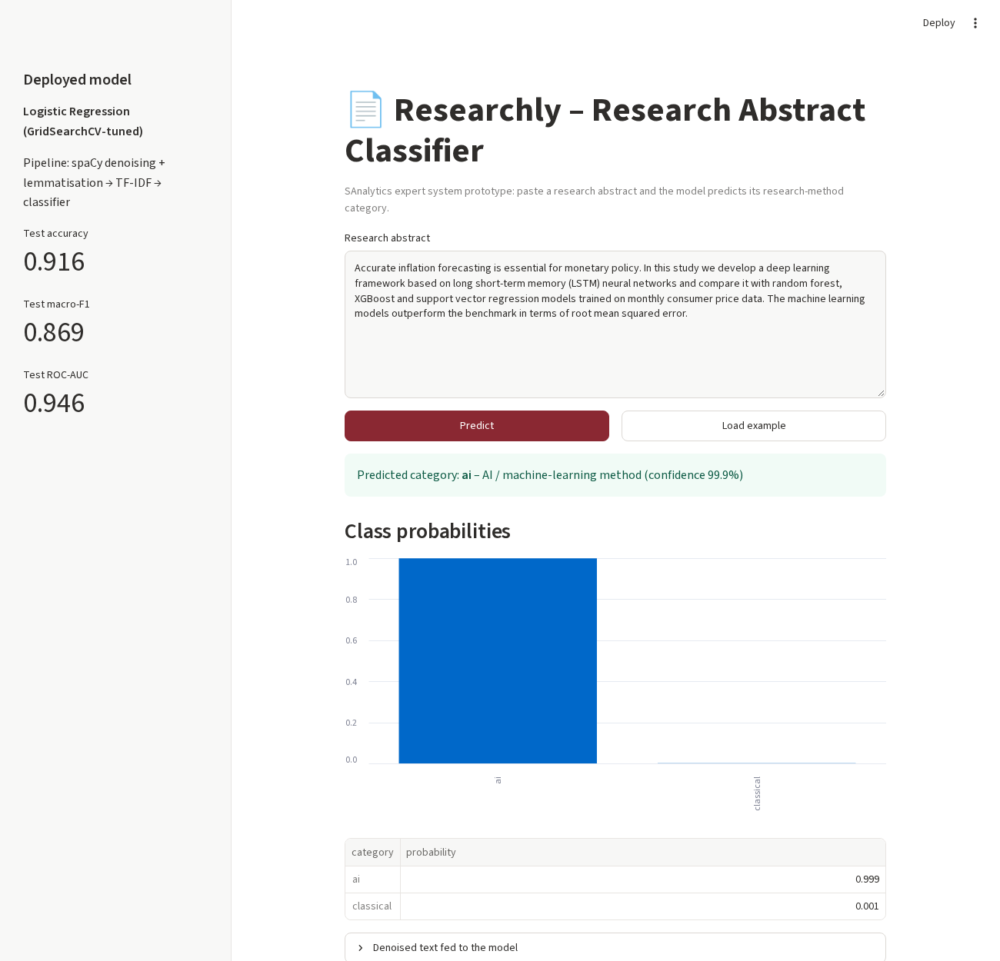

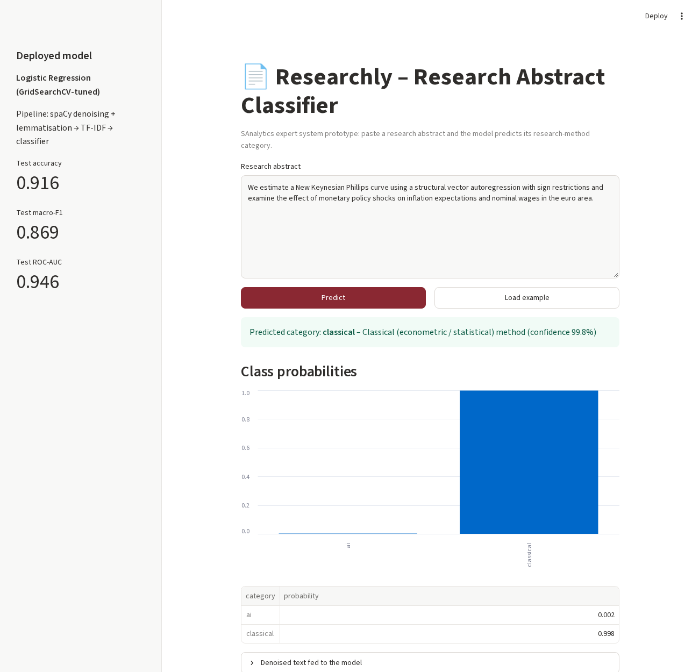

---

# Part B – Topic Analysis: Research Document Mining (Questions 3 and 4)

> **Note on the corpus.** The brief describes `research_corpus.zip` as "recent AI research articles". On inspection, however, the five files are **research-methodology** papers: mixed methods, reflexivity, developmental research, Cronbach's alpha and triangulation. The pipeline does not depend on the domain, so I analysed the corpus as supplied and interpreted the topics accordingly. The same prototype would work unchanged on an AI-paper corpus.

## 3.1 Articles data frame (5 marks)

I read the zip archive directly with `zipfile` (no manual extraction) and built one row per article. I identified the titles from each article's text.

```python
rows = []
with zipfile.ZipFile("../datasets/research_corpus.zip") as z:
    for name in sorted(z.namelist()):
        if name.endswith(".txt"):
            rows.append({"doc_id": int(re.search(r"(\d+)", name).group(1)), "file": name,
                         "content": z.read(name).decode("utf-8", errors="replace")})
corpus = pd.DataFrame(rows).sort_values("doc_id").reset_index(drop=True)
corpus["n_words"] = corpus.content.str.split().str.len()
```

| doc_id | File | Article (identified from text) | Characters | Words | Lines |
|---|---|---|---|---|---|
| 1 | research_1.txt | Mixed methods research: a research paradigm whose time has come (Johnson & Onwuegbuzie, 2004) | 38 598 | 5 602 | 439 |
| 2 | research_2.txt | Now I see it, now I don't: researcher's position and reflexivity in qualitative research (Berger, 2015) | 16 279 | 2 416 | 176 |
| 3 | research_3.txt | Developmental research: studies of instructional design and development (Richey, Klein & Nelson, 2004) | 26 521 | 3 828 | 368 |
| 4 | research_4.txt | The use of Cronbach's alpha when developing and reporting research instruments in science education (Taber, 2018) | 39 072 | 5 922 | 123 |
| 5 | research_5.txt | Denzin's paradigm shift: revisiting triangulation in qualitative research (Fusch, Fusch & Ness, 2018) | 27 142 | 4 027 | 312 |

The data frame holds the full raw `content` of every article. The notebook adds columns at each later stage (`clean_text`, `sentences`, `tokens`), and the result is saved as `datasets/research_corpus_clean.csv`.

## 3.2 Preprocessing (6 marks)

The raw text was extracted from PDFs and web pages, so it is noisy. It has hard line breaks in the middle of sentences, author and affiliation blocks ("Patricia Fusch / Walden University"), e-mail and DOI junk, web boilerplate ("Similar content being viewed by others", "Full size image"), section headings, in-text citations, footnote markers ("dispute.1") and curly quotes. Article 1 also contains **its whole body twice**. I applied a layered denoising pipeline:

1. **Layout and boilerplate removal:** NFKC Unicode normalisation (ligatures and curly quotes); a line filter that removes affiliations, e-mail/DOI lines, web boilerplate and Title-Case headings or author names; de-hyphenation of words split across lines; and re-flowing of hard line breaks.
2. **Regex denoising:** parenthetical citations containing years, URLs, e-mails, section numbers, bracketed notes, footnote markers and figure/table source captions.
3. **spaCy sentence segmentation and duplicate-sentence removal:** this removed **76 duplicated sentences from article 1** (152 → 76) and 1 from article 5.
4. **spaCy linguistic filtering:** lemmatisation; a POS filter that keeps only NOUN, VERB, ADJ and PROPN; **named-entity filtering** (PERSON, GPE, DATE, CARDINAL and similar are dropped); removal of stop words and domain stop words; and a minimum token length of 3.
5. **Collocation detection with gensim `Phrases`** (min_count = 4, threshold = 8), which joins frequent bigrams such as `mixed_method`, `science_education`, `internal_consistency`, `cronbach_alpha` and `methodological_triangulation`.

```python
def to_tokens(sent):
    return [t.lemma_.lower() for t in sent
            if t.ent_type_ not in DROP_ENTS and t.is_alpha and not t.is_stop
            and t.pos_ in {"NOUN", "ADJ", "VERB", "PROPN"} and len(t.lemma_) > 2
            and t.lemma_.lower() not in DOMAIN_STOP]
docs = list(nlp.pipe(corpus.clean_text))                      # after layout + regex denoising
uniq = [unique_sents(d) for d in docs]                          # drop duplicate sentences
sent_tokens = [[to_tokens(s) for s in u] for u in uniq]
phrases = Phraser(Phrases([s for d in sent_tokens for s in d], min_count=4, threshold=8,
                          connector_words=ENGLISH_CONNECTOR_WORDS))
corpus["tokens"] = [[t for s in d for t in phrases[s]] for d in sent_tokens]
```

| Article | Raw words | Clean tokens | Bigram tokens | Sentences (before → after de-duplication) |
|---|---|---|---|---|
| 1 | 5 602 | 1 104 | 35 | 152 → 76 |
| 2 | 2 416 | 892 | 11 | 59 → 59 |
| 3 | 3 828 | 1 505 | 55 | 154 → 154 |
| 4 | 5 922 | 2 320 | 122 | 183 → 183 |
| 5 | 4 027 | 1 488 | 117 | 154 → 153 |

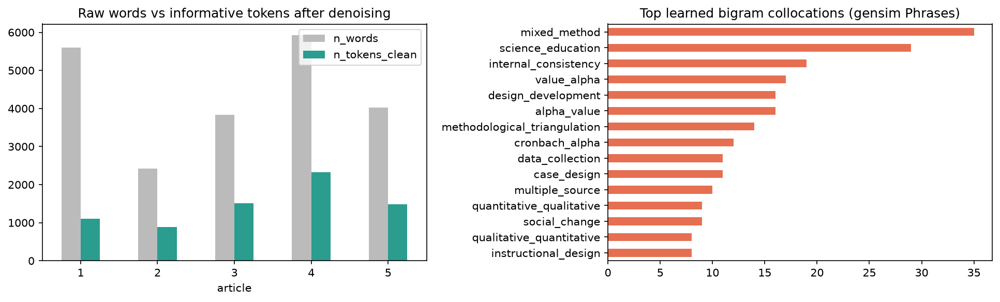

Two cleaned representations are kept: (i) **cleaned sentences**, which are readable and used for extractive summarisation in Q3.3–3.4, and (ii) **lemmatised token lists with bigrams**, used for TF-IDF, LSA and LDA.

## 3.3 Summary of the first article – TextRank (5 marks)

**Technique.** For article 1 I used extractive **TextRank** (Mihalcea & Tarau, 2004). Each de-duplicated sentence becomes a node in a graph, and the edges are weighted by the cosine similarity of the sentences' TF-IDF vectors (built from the lemmatised tokens). Sentences are ranked with PageRank (damping factor 0.85), and the top 6 are returned in their original order.

```python
def textrank(sentences, token_lists, top_n=6, damping=0.85):
    X = TfidfVectorizer().fit_transform([" ".join(t) for t in token_lists])
    sim = cosine_similarity(X); np.fill_diagonal(sim, 0)
    scores = nx.pagerank(nx.from_numpy_array(sim), alpha=damping, weight="weight")
    chosen = sorted(sorted(scores, key=scores.get, reverse=True)[:top_n])
    return chosen, scores
```

**Summary of article 1** (6 of 76 sentences; 188 of 2 584 words, about 7% of the text):

> The purposes of this article are to position mixed methods research (mixed research is a synonym) as the natural complement to traditional qualitative and quantitative research, to present pragmatism as offering an attractive philosophical partner for mixed methods research, and to provide a framework for designing and conducting mixed methods research. Both sets of purists view their paradigms as the ideal for research, and, implicitly if not explicitly, they advocate the incompatibility thesis, which posits that qualitative and quantitative research paradigms, including their associated methods, cannot and should not be mixed. Our purpose in writing this article is to present mixed methods research as the third research paradigm in educational research. For example, qualitative researchers should be free to use quantitative methods, and quantitative researchers should be free to use qualitative methods. We contend that epistemological and paradigmatic ecumenicalism is within reach in the research paradigm of mixed methods research. For example, differences in epistemological beliefs (such as a difference in beliefs about the appropriate logic of justification) should not prevent a qualitative researcher from utilizing data collection methods more typically associated with quantitative research, and vice versa.

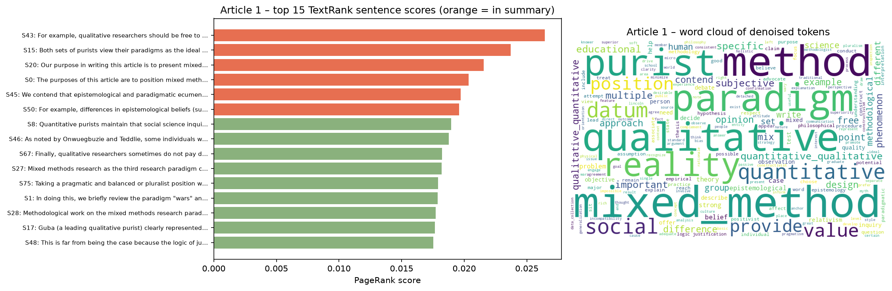

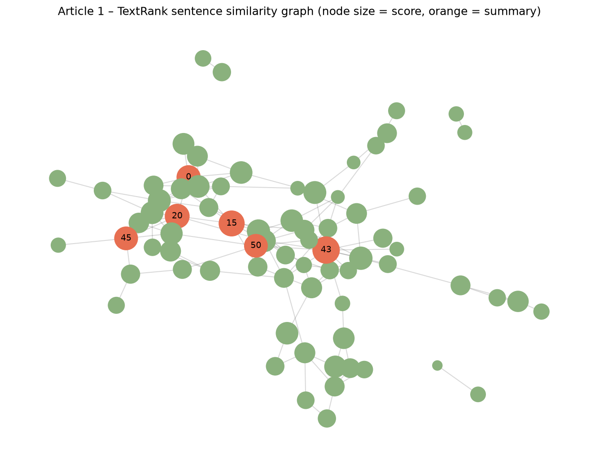

**Interpretation.** The summary captures the article's argument well:

* the quantitative–qualitative "paradigm wars" and the incompatibility thesis;
* the authors' position that mixed methods research is a **third research paradigm**;
* **pragmatism** as its philosophical partner.

The most frequent tokens (`mixed_method`, `method`, `paradigm`, `reality`, `qualitative`, `purist`) confirm this focus. Removing the duplicated body was essential. Before de-duplication, TextRank picked the same three sentences twice, because duplicate sentences reinforce each other in the similarity graph.

## 3.4 Aggregate summary of the remaining articles – LSA (9 marks)

**Technique.** For articles 2–5 together I used a different, **topic-based** extractive method: **Latent Semantic Analysis (LSA) summarisation**.

1. Pool all 540 cleaned sentences from articles 2–5 and build a sentence × term TF-IDF matrix A (813 terms, `min_df = 2`).
2. Decompose it with truncated SVD into **8 latent concepts**: A ≈ U Σ Vᵀ.
3. **Concept-wise selection** (Gong & Liu, 2001): for each concept, take the sentence that loads most strongly on it, so every main theme is covered.
4. Fill the remaining slots with the **Steinberger & Ježek (2004)** score, which is the length of the sentence's vector in the Σ-weighted latent space: ‖(UΣ)ᵢ‖.
5. Apply a redundancy filter (cosine < 0.5 to sentences already chosen) and return **10 sentences**.

```python
A = TfidfVectorizer(min_df=2, sublinear_tf=True).fit_transform(agg_toks)  # sentences x terms
svd = TruncatedSVD(n_components=8, random_state=42); U = svd.fit_transform(A)  # U*Sigma
lsa_score = np.sqrt((U ** 2).sum(axis=1))                                # Steinberger & Jezek
for c in range(8):                                                       # Gong & Liu
    chosen.append(next(i for i in np.argsort(-np.abs(U[:, c])) if i not in chosen and novel(i, chosen)))
```

**Latent concepts (top terms):**

* C1: instrument, report, scale, alpha, reliability
* C2: triangulation, datum, method, denzin, methodological_triangulation
* C3: development, process, developmental, instructional, design
* C4: science_education, statistic, field, publish, alpha
* C5: development, scale, datum, reliability, term
* C6: design, method, mixed_method, example, scale
* C7: knowledge, student, understanding, design, instrument
* C8: reliability, design, term, mixed_method, result

**Aggregate summary of articles 2–5** (10 of 540 sentences):

| Article | Selected by | Sentence |
|---|---|---|
| 2 | Concept 5 | Benefits and challenges to reflexivity under three types of researcher's position are discussed and illustrated by means of case examples: (1) reflexivity when researcher shares the experience of study participants, (2) reflexivity when researcher moves from the position of an outsider to the position of an insider in the course of the study, and (3) reflexivity when researcher has no personal familiarity or experience with what is being studied. |
| 3 | Concept 3 | While instructional development typically builds on previous research, developmental research attempts to produce the models and principles that guide the design, development, and evaluation processes. |
| 4 | Concept 4 | This paper presents findings from that survey, to illustrate the extent and nature of the use of Cronbach's alpha in published reports of science education in highly regarded journals in the field, as well as exploring identified issues of concern by discussing examples from the literature consulted. |
| 4 | Concept 8 | Alpha is commonly reported for the development of scales intended to measure attitudes and other affective constructs. |
| 4 | Concept 1 | However, the literature also includes reports of the development of tests of student knowledge and understanding that cite Cronbach's alpha as an indicator of instrument quality. |
| 4 | S&J score | It would be suspect if the correlations between these scales were very high, as that would suggest that the sets of items making up the different scales were not measuring different factors. |
| 4 | Concept 7 | This instrument was said to measure "knowledge level of biotechnology and genetics" and it was reported that "the reliability (Cronbach's α) of the knowledge questionnaire was .721" (p. 2930). |
| 5 | S&J score | Using triangulation such as multiple sources of data contributes to the reliability of results and saturation of data. |
| 5 | Concept 6 | However, along with its benefits, a mixed-methods design has a great deal of complexity in the data collection methods – much more than other designs. |
| 5 | Concept 2 | Since Denzin initially defined the four types of triangulation in social research, there has been confusion between data triangulation and methodological triangulation. |

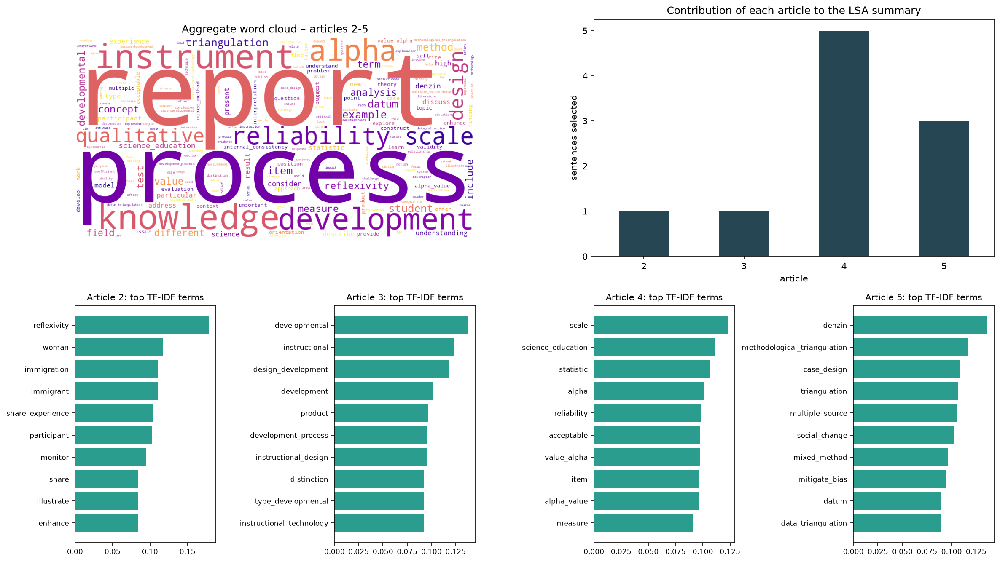

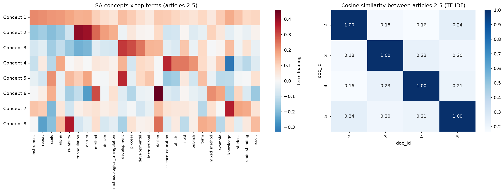

**Interpretation.** In aggregate, articles 2–5 deal with **how to make research trustworthy**:

* the researcher's own position and **reflexivity** in qualitative work (article 2);
* **developmental research** that produces models for instructional design (article 3);
* how instrument **reliability** is reported through **Cronbach's alpha** (article 4);
* **triangulation** of data and methods to reduce bias and reach saturation (article 5).

The concept-wise selection makes sure that every article appears in the summary, whereas a pure Steinberger & Ježek ranking in an earlier run picked sentences only from articles 4 and 5. Article 4 still contributes the most sentences (5 of 10) because it is the longest article and dominates several latent concepts. The similarity heat map shows that the four articles are lexically distinct (pairwise cosine 0.16–0.24); articles 2 and 5, both on qualitative rigour, are the closest pair (0.24). The 8 concepts explain about 7.9% of the TF-IDF variance, which is typical for sparse sentence-level text matrices, but they are clearly interpretable.

---

## 4.1 LDA topics (12 marks)

**Set-up.** LDA (Blei, Ng & Jordan, 2003) needs many documents to estimate topic mixtures, and five articles are too few. I therefore split each article into **passages of 10 consecutive cleaned sentences**, which gives **65 passages**, and aggregated the passage-level topic distributions back to the articles. I built a gensim `Dictionary` and filtered extreme terms (kept if in ≥ 3 passages and ≤ 50% of passages), leaving **584 terms**. Each LDA model uses 30 passes, 400 iterations, and `alpha` and `eta` learned from the data (`'auto'`).

**Choosing n.** I trained models for n = 2…10 topics with **three random seeds each** and scored them with **C_v topic coherence** (Röder, Both & Hinneburg, 2015). I also recorded UMass coherence and log-perplexity.

```python
for k in range(2, 11):
    for seed in [42, 7, 2026]:
        m = LdaModel(bow, num_topics=k, id2word=dictionary, passes=30, iterations=400,
                     alpha="auto", eta="auto", random_state=seed)
        cv = CoherenceModel(model=m, texts=passages, dictionary=dictionary, coherence="c_v").get_coherence()
BEST_K = int(coh[coh.c_v >= coh.c_v.max() - 0.01].k.min())   # parsimony rule
```

| n topics | Mean C_v | SD (3 seeds) | UMass | Log-perplexity |
|---|---|---|---|---|
| 2 | 0.395 | 0.072 | −2.585 | −5.966 |
| **3** | **0.486** | **0.018** | −2.017 | −5.909 |
| 4 | 0.425 | 0.067 | −2.828 | −5.983 |
| 5 | 0.424 | 0.090 | −3.126 | −6.020 |
| 6 | 0.465 | 0.031 | −2.710 | −6.004 |
| 7 | 0.441 | 0.004 | −2.878 | −6.025 |
| 8 | 0.471 | 0.048 | −2.398 | −6.049 |
| 9 | 0.466 | 0.042 | −2.434 | −6.088 |
| 10 | 0.472 | 0.024 | −2.609 | −6.082 |

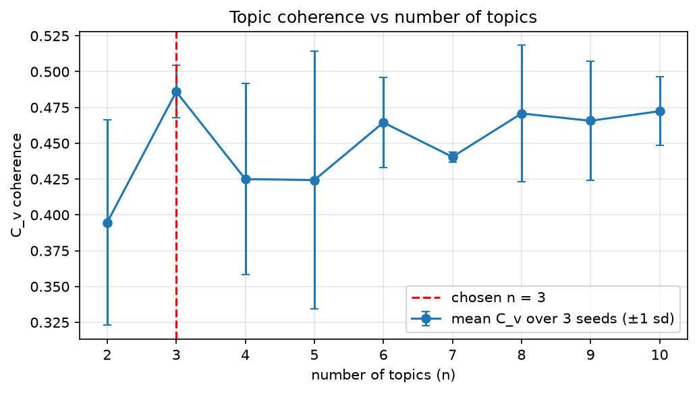

**n = 3** has the highest mean C_v (0.486), one of the smallest variances across seeds, and the best UMass score (−2.017), so I chose **n = 3 topics**. The final model (seed 42) has **C_v = 0.498**, with per-topic coherence of 0.724, 0.446 and 0.325.

**Topics: word lists and probabilities.**

| Topic | Top 10 words (probability) | Interpretation |
|---|---|---|
| 1 | instrument (0.028), report (0.026), alpha (0.024), scale (0.022), reliability (0.021), item (0.020), measure (0.015), test (0.015), science_education (0.014), student (0.013) | **Measurement and instrument reliability** (Cronbach's alpha) |
| 2 | process (0.023), development (0.022), developmental (0.015), reflexivity (0.013), knowledge (0.013), design (0.012), evaluation (0.010), model (0.010), instructional (0.009), product (0.009) | **Research process: developmental and reflexive research design** |
| 3 | datum (0.035), triangulation (0.028), method (0.027), qualitative (0.023), denzin (0.013), design (0.012), multiple (0.011), participant (0.010), mixed_method (0.010), point (0.010) | **Qualitative and mixed-methods rigour: triangulation of data and methods** |

(`datum` is spaCy's lemma of "data".)

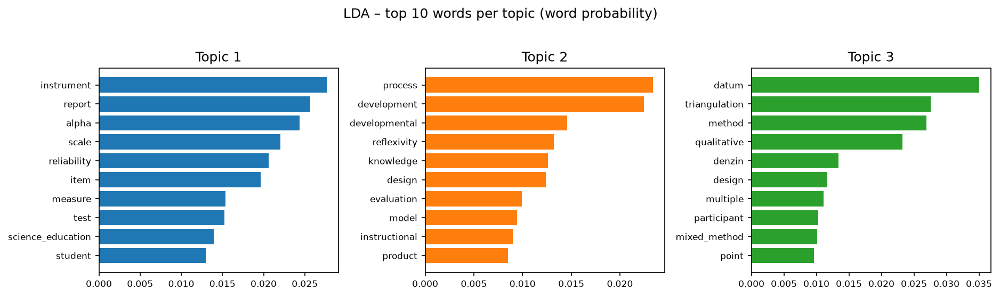

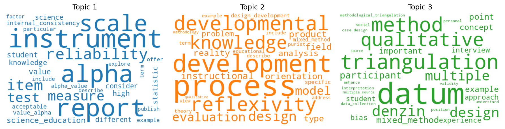

**Topic distribution per article** (mean of the passage-level θ):

| Article | Topic 1 | Topic 2 | Topic 3 | Dominant topic |
|---|---|---|---|---|
| 1 Mixed methods (Johnson & Onwuegbuzie) | 0.023 | 0.607 | 0.370 | Topic 2 |
| 2 Reflexivity (Berger) | 0.000 | 0.336 | 0.664 | Topic 3 |
| 3 Developmental research (Richey et al.) | 0.012 | 0.987 | 0.001 | Topic 2 |
| 4 Cronbach's alpha (Taber) | 0.999 | 0.000 | 0.000 | Topic 1 |
| 5 Triangulation (Fusch et al.) | 0.000 | 0.018 | 0.981 | Topic 3 |

Across the whole corpus the three topics are evenly balanced. By dominant topic, the passages split 19 / 25 / 21, and pyLDAvis estimates the token shares at 33.8%, 34.0% and 32.2%.

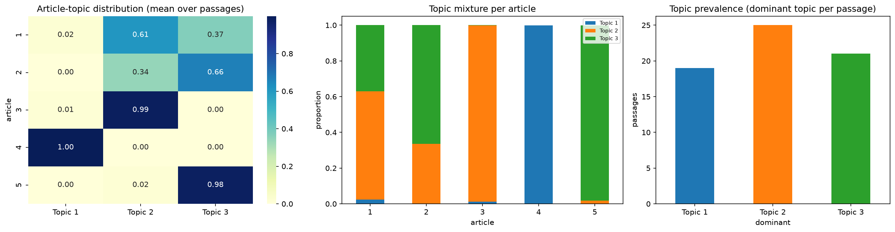

**Interpretation.** The corpus is organised around three methodological themes:

1. **quantitative measurement quality**, almost entirely article 4;
2. **the research and design process**, mainly article 3 and the paradigm and philosophy discussion in article 1;
3. **qualitative and mixed-methods rigour through triangulation**, mainly articles 5 and 2.

The mixed-methods article (1) is the most "mixed" document, which makes sense because it bridges the quantitative and qualitative traditions. With six topics (mean C_v 0.465) LDA would give each article its own theme, but the gain in coherence does not justify it, and the 3-topic solution was the most stable across seeds. For Researchly's trend-tracking aim, the same pipeline run on a larger corpus with dates would allow topic prevalence to be tracked over time.

## 4.2 Intertopic Distance Map – pyLDAvis (5 marks)

I visualised the final 3-topic model with **pyLDAvis** (Sievert & Shirley, 2014) and saved it as a stand-alone interactive HTML page (`docs/lda_intertopic_distance_map.html`):

```python
import pyLDAvis, pyLDAvis.gensim_models as gensimvis
vis = gensimvis.prepare(lda, bow, dictionary, sort_topics=False, mds="mmds", R=20)
pyLDAvis.save_html(vis, "../docs/lda_intertopic_distance_map.html")
```

* **Left panel – intertopic distance map.** Each topic is a circle, positioned by metric multidimensional scaling of the Jensen–Shannon divergence between topic–word distributions. Circle area shows how common the topic is (33.8%, 34.0% and 32.2% of tokens). The three circles **do not overlap** and lie in different parts of the plane (Topic 1 at (0.09, 0.16), Topic 2 at (0.08, −0.13), Topic 3 at (−0.17, −0.04)), so the topics are well separated.
* **Right panel – the 20 most salient terms overall** (saliency as defined by Chuang, Manning & Heer, 2012): datum, triangulation, alpha, instrument, method, scale, item, report, development, reliability, measure, process, developmental, science_education, denzin, qualitative, test, statistic, participant, high.
* **Selecting a topic** shows its most relevant terms, adjustable with the λ slider. At λ = 0.6, the most relevant terms are:
  * Topic 1: instrument, alpha, report, scale, item, reliability, measure, test, science_education, statistic
  * Topic 2: process, development, developmental, reflexivity, evaluation, model, instructional, product, orientation, knowledge
  * Topic 3: datum, triangulation, method, qualitative, denzin, participant, multiple, point, interview, bias

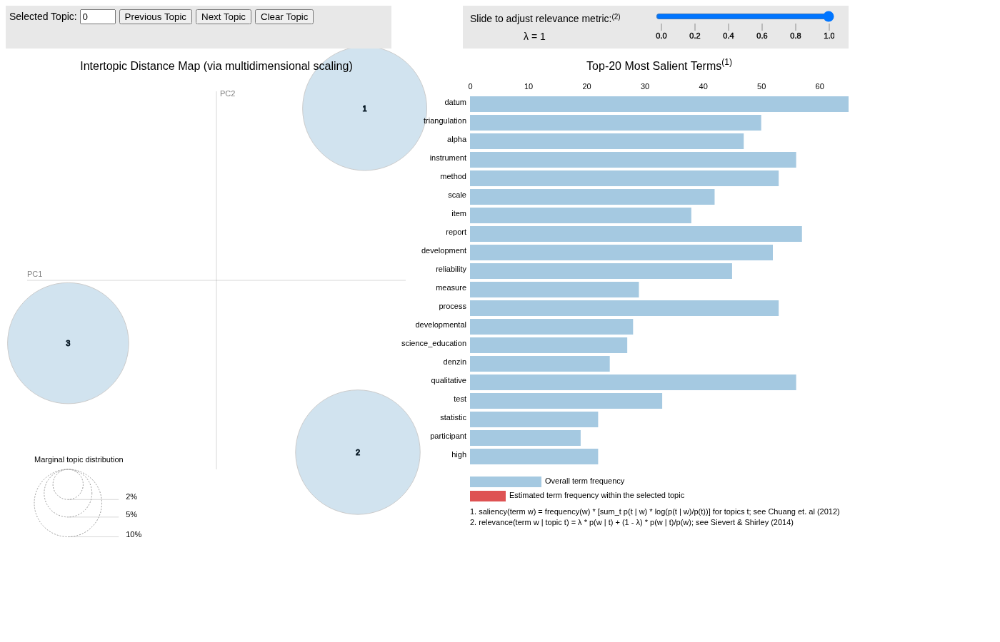

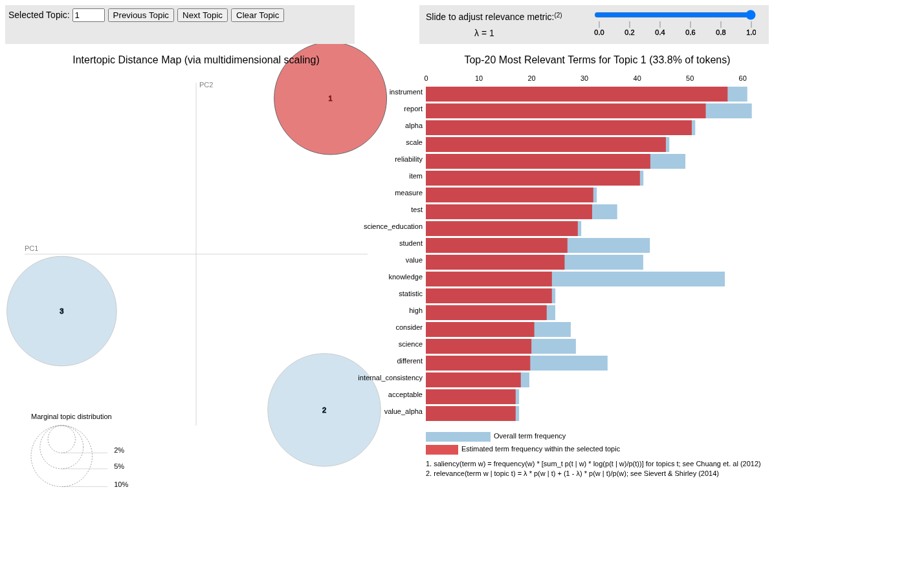

## 4.3 GitHub repository (8 marks)

I set up the project as a Git repository with this structure:

```
itnpa4-researchly/
├── README.md                    # project overview, structure, how to reproduce
├── requirements.txt             # full environment for the notebooks
├── docs/
│   ├── PROJECT_DOCUMENTATION.md # project documentation for Questions 1–4 (this write-up)
│   ├── lda_intertopic_distance_map.html   # interactive pyLDAvis map (Q4.2)
│   └── figures/                 # all figures (Q1–Q4) as PNG
├── datasets/
│   ├── research_abstracts.json  # original dataset (Q1–2)
│   ├── research_corpus.zip      # original corpus (Q3–4)
│   ├── research_abstracts_clean.csv
│   └── research_corpus_clean.csv
├── notebooks/
│   ├── Q1_Q2_Researchly_Expert_System.ipynb   # executed, with outputs
│   └── Q3_Q4_Topic_Analysis.ipynb             # executed, with outputs
├── results/                     # JSON of all computed metrics (traceability)
└── deployment/
    ├── README.md                # easy deployment (local / Docker / Streamlit Cloud)
    ├── app.py, preprocess.py, model.joblib, model_meta.json
    ├── requirements.txt, Dockerfile
```

* **Project documentation (Q1–4):** `docs/PROJECT_DOCUMENTATION.md` and the top-level `README.md`.
* **Datasets:** the original `research_abstracts.json` and `research_corpus.zip`, plus the cleaned outputs.
* **Notebooks:** two executed Jupyter notebooks that show the full analytics flow for Questions 1–2 and 3–4, with all outputs and figures embedded.
* **Deployment folder:** the Streamlit app, the trained model, pinned `requirements.txt`, a `Dockerfile`, and a `README.md` with three-command local deployment (`pip install -r requirements.txt` then `streamlit run app.py`), plus Docker and Streamlit Community Cloud options.

The repository is committed locally with Git and is ready to push to GitHub with:

```bash
git remote add origin https://github.com/euclid-thakanyane/ITNPA4-Text-Mining-Project.git
git branch -M main
git push -u origin main
```

**GitHub repository link:** https://github.com/euclid-thakanyane/ITNPA4-Text-Mining-Project

---

# References

Blei, D.M., Ng, A.Y. & Jordan, M.I. 2003. Latent Dirichlet allocation. *Journal of Machine Learning Research*, 3:993–1022.

Berger, R. 2015. Now I see it, now I don't: researcher's position and reflexivity in qualitative research. *Qualitative Research*, 15(2):219–234.

Chuang, J., Manning, C.D. & Heer, J. 2012. Termite: visualization techniques for assessing textual topic models. In *Proceedings of the International Working Conference on Advanced Visual Interfaces (AVI '12)*. Capri Island: ACM, 74–77.

Fusch, P., Fusch, G.E. & Ness, L.R. 2018. Denzin's paradigm shift: revisiting triangulation in qualitative research. *Journal of Social Change*, 10(1):19–32.

Gong, Y. & Liu, X. 2001. Generic text summarization using relevance measure and latent semantic analysis. In *Proceedings of the 24th Annual International ACM SIGIR Conference on Research and Development in Information Retrieval*. New Orleans: ACM, 19–25.

Honnibal, M., Montani, I., Van Landeghem, S. & Boyd, A. 2020. *spaCy: industrial-strength natural language processing in Python*. Zenodo. doi:10.5281/zenodo.1212303.

Johnson, R.B. & Onwuegbuzie, A.J. 2004. Mixed methods research: a research paradigm whose time has come. *Educational Researcher*, 33(7):14–26.

Manning, C.D., Raghavan, P. & Schütze, H. 2008. *Introduction to information retrieval*. Cambridge: Cambridge University Press.

Matanga, N.Y. 2026. *ITNPA4-B34 project brief: research papers expert system and topic analysis – research document mining*. Unpublished assessment brief. Eduvos.

Mihalcea, R. & Tarau, P. 2004. TextRank: bringing order into texts. In *Proceedings of the 2004 Conference on Empirical Methods in Natural Language Processing*. Barcelona: Association for Computational Linguistics, 404–411.

Mikolov, T., Sutskever, I., Chen, K., Corrado, G.S. & Dean, J. 2013. Distributed representations of words and phrases and their compositionality. *Advances in Neural Information Processing Systems*, 26:3111–3119.

Pedregosa, F., Varoquaux, G., Gramfort, A., Michel, V., Thirion, B., Grisel, O., Blondel, M., Prettenhofer, P., Weiss, R., Dubourg, V., Vanderplas, J., Passos, A., Cournapeau, D., Brucher, M., Perrot, M. & Duchesnay, É. 2011. Scikit-learn: machine learning in Python. *Journal of Machine Learning Research*, 12:2825–2830.

Řehůřek, R. & Sojka, P. 2010. Software framework for topic modelling with large corpora. In *Proceedings of the LREC 2010 Workshop on New Challenges for NLP Frameworks*. Valletta: ELRA, 45–50.

Rennie, J.D.M., Shih, L., Teevan, J. & Karger, D.R. 2003. Tackling the poor assumptions of naive Bayes text classifiers. In *Proceedings of the Twentieth International Conference on Machine Learning (ICML-2003)*. Washington, DC: AAAI Press, 616–623.

Richey, R.C., Klein, J.D. & Nelson, W.A. 2004. Developmental research: studies of instructional design and development. In Jonassen, D.H. (ed.) *Handbook of research on educational communications and technology*. 2nd ed. Mahwah, NJ: Lawrence Erlbaum Associates, 1099–1130.

Röder, M., Both, A. & Hinneburg, A. 2015. Exploring the space of topic coherence measures. In *Proceedings of the Eighth ACM International Conference on Web Search and Data Mining (WSDM '15)*. Shanghai: ACM, 399–408.

Sievert, C. & Shirley, K. 2014. LDAvis: a method for visualizing and interpreting topics. In *Proceedings of the Workshop on Interactive Language Learning, Visualization, and Interfaces*. Baltimore: Association for Computational Linguistics, 63–70.

Steinberger, J. & Ježek, K. 2004. Using latent semantic analysis in text summarization and summary evaluation. In *Proceedings of the 7th International Conference on Information Systems Implementation and Modelling (ISIM '04)*. Rožnov pod Radhoštěm, 93–100.

Streamlit. 2026. *Streamlit documentation*. [Online]. Available at: https://docs.streamlit.io [Accessed: 12 November 2026].

Taber, K.S. 2018. The use of Cronbach's alpha when developing and reporting research instruments in science education. *Research in Science Education*, 48(6):1273–1296.
